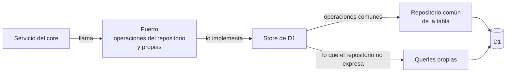

# Acceso a datos

## 🔭 Resumen

La API lee y escribe en D1 a través de un repositorio común que tiene las mismas operaciones para cada tabla: leer por id, filtrar, listar con paginación, contar, crear, actualizar, insertar o actualizar, y borrar. El core declara en el puerto de cada entidad las operaciones del repositorio que usa y las operaciones propias que necesita. El store de D1 de cada entidad arma el puerto con el repositorio de su tabla y escribe a mano solo las queries que el repositorio no puede expresar sin sumar idas a la base. Cada fila que sale de la base pasa por el decoder de su store, que la valida y la convierte al tipo que usa el core, antes de llegar al core. Los ids los genera el core antes de crear una fila.

## 🏗️ Del servicio a la tabla

El puerto de las manos levantadas, por ejemplo, toma insertar o actualizar y borrar por filtro, y suma la lista de manos de una sesión con el nombre y el avatar de cada estudiante. Así, el tipo del puerto lista las operaciones que el core usa sobre cada tabla.

## ♠️ Qué ofrece el repositorio

| Operación | Responde |
|---|---|
| leer por id | la fila, o nada si no existe |
| leer varias por id | las que existen, ordenadas por id |
| buscar | la primera fila que cumple un filtro, ordenada por id |
| listar | las filas que cumplen un filtro, en el orden pedido, de a una página |
| contar | cuántas filas cumplen un filtro |
| crear, crear varias | las filas creadas, leídas de nuevo |
| actualizar | la fila actualizada, o nada si no existe |
| actualizar por filtro | cuántas filas cambió |
| insertar o actualizar | nada; con un conflicto en las columnas que se le indican, deja la fila como estaba o la actualiza |
| borrar, borrar por filtro | borrar devuelve la fila borrada y borrar por filtro cuántas borró; con la opción de devolver lo borrado, las dos devuelven las filas borradas |

Un filtro compara cada campo: si recibe un valor, pide que el campo sea igual; si recibe una lista, que esté en la lista; si recibe null, que esté vacío. Los campos se juntan con "y". En una tabla con borrado lógico, toda lectura deja afuera las filas borradas, y borrar marca la fila con la fecha en lugar de eliminarla.

## 🧭 Orden y páginas

Una lista termina siempre ordenada por id, después de los órdenes que se le piden, así que el orden es total. Quien lista indica, para cada orden, si los vacíos van primero o último. Si no lo indica, van primero en orden ascendente y último en descendente. Por ejemplo, la lista de usuarios del profe va por nombre, con los que todavía no completaron el perfil al final, y después por email.

Una página tiene como mucho 100 filas. La siguiente se pide con la última fila de la anterior, y el repositorio arma la condición que trae las filas posteriores a esa, con cada campo del orden, vacíos incluidos.

> [!NOTE] Por qué el tope de 100 vale solo para listar
> El tope evita que un endpoint que lista filas devuelva una cantidad sin límite, como la lista de usuarios. La lista de novedades usa un tope menor, de 50. Las queries propias que juntan datos, como los conteos de las encuestas o las manos de una sesión, traen todo lo que corresponde en una sola query y no llevan tope.

## ✍️ Escrituras y batches

Crear y actualizar escriben y después vuelven a leer la fila, para devolverla decodificada. Borrar sin la opción de devolver lo borrado lee la fila y después la borra, en dos idas. Con la opción, la base borra y devuelve las filas en la misma sentencia. Insertar o actualizar es siempre una sola sentencia, así que dos pedidos a la vez sobre la misma fila no se pisan.

Cada escritura existe también como sentencia sin ejecutar. Varias sentencias, de una tabla o de varias, corren juntas y en orden en un batch de D1. Si una falla, D1 no aplica ninguna. Por ejemplo, regenerar el código de registro marca el código vigente como borrado y crea el nuevo en un batch, así que nunca queda la app sin código vigente.

> [!NOTE] Por qué una sentencia de batch no devuelve filas
> D1 devuelve las filas de un batch tal como están en la tabla, con los nombres de las columnas y las fechas como números, sin pasar por el mapeo que hace el query builder. Para no devolver filas con una forma distinta de la que declara su tipo, una sentencia de batch no devuelve nada. Quien necesita la fila la lee después del batch.

> [!NOTE] Por qué hay type guards en el repositorio
> Sobre una tabla genérica, el query builder no puede tipar las filas que devuelve una escritura. Tampoco puede tipar el cambio de un borrado lógico ni el de un insertar o actualizar. El repositorio les da su tipo con type guards en lugar de aserciones. Los type guards comprueban la forma de lo que llega antes de usarlo: que sea una lista de filas y que las claves del cambio sean columnas de la tabla.

## 🧩 Queries propias

Un store escribe su propia query cuando el repositorio no puede expresarla o la resolvería con más idas a la base. El repositorio lee una sola tabla por vez y corre una operación por sentencia, así que las lecturas que unen tablas o cuentan, y las escrituras que tienen que caer juntas, quedan en su store:

| Store | Query propia |
|---|---|
| respuestas | los conteos de varias encuestas en una sola query: votos por opción o punto de la escala, el total y las palabras de cada nube, contadas una vez por estudiante; y las respuestas de una encuesta de feedback con el nombre y el avatar de cada alumno |
| manos levantadas | las manos de una sesión con el nombre y el avatar de cada estudiante, ordenadas por nombre |
| preguntas | la lista y una pregunta, cada una con sus votos y si el que pide la votó |
| material | crear, marcar como slides y borrar; cuando cambian las slides de la sesión, el mismo batch desmarca las anteriores y vuelve la posición del profe a la primera slide |
| sesiones | crear en la posición siguiente a la última, y reordenar todas las posiciones en un batch |
| códigos | asegurar el código de registro vigente |

> [!NOTE] Por qué el código de registro vigente tiene su propia query
> El código vigente es único por un índice parcial, que vale solo para los códigos de registro sin fecha de borrado. Un insertar o actualizar nombra las columnas del conflicto y no puede nombrar ese índice, así que el store inserta el candidato solo si no hay otro vigente.

> [!TIP] Joins en el repositorio, considerados y no elegidos
> El repositorio podría unir tablas con relaciones declaradas, pedidas en cada lectura. No se eligió porque el tipo del resultado depende de qué relaciones se piden, y cada store tendría que decodificar cada combinación. Las pocas lecturas que unen tablas son queries propias de su store.

> [!TIP] Ids generados por el repositorio, considerados y no elegidos
> El repositorio podría generar el id al crear una fila. No se eligió porque algunas escrituras necesitan el id antes de que exista la fila: el archivo de un material se guarda en R2 con el id del material, y el registro crea el usuario y su código en un batch, con el id del usuario en el código.

## 📏 Límites de D1

Una query de D1 acepta como mucho 100 parámetros. Cada elemento de un filtro por lista es un parámetro, y el repositorio no parte las listas largas. Los conteos de las encuestas pasan los ids como un solo parámetro con la lista en JSON. La API rechaza un anuncio con más de 50 novedades elegidas. Así, las queries de los conteos y las del anuncio quedan debajo del límite.

> [!WARNING] Un filtro por una lista larga falla en D1
> Si una lectura filtra por una lista que, sumada a los otros parámetros de la query, pasa los 100, como las encuestas de muchas sesiones habilitadas, D1 rechaza la query y el pedido falla. El D1 local de los tests no aplica el límite, así que ningún test lo detecta.

---

Related: [modelo de datos](modelo-de-datos.md), [componentes](componentes.md), [novedades por mail](novedades-por-mail.md), [login y acceso](login-y-acceso.md)
