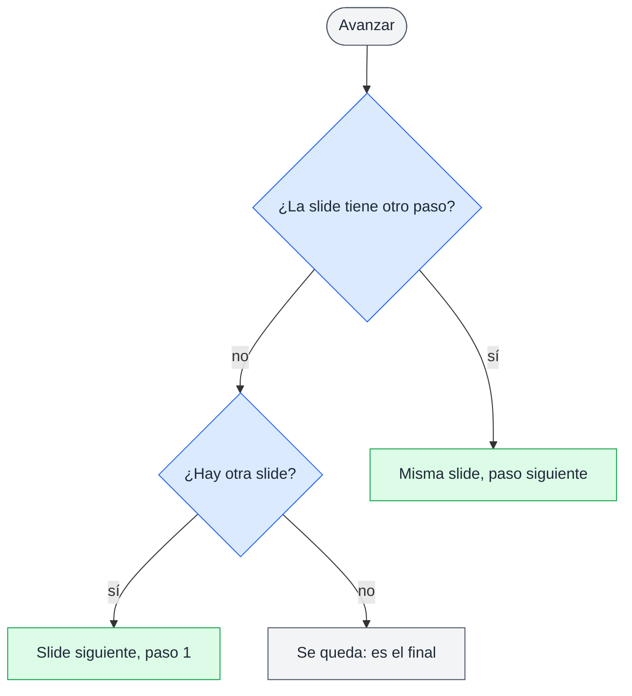
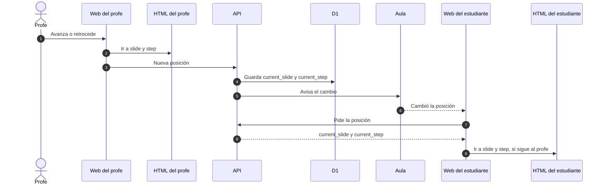

# API de las slides

## 🔭 Resumen

Las slides de una sesión son un archivo HTML que el profe sube como material y marca como slides. La web lo carga en el aula y habla con él por una API propia de dos mensajes: al cargar, el HTML le pasa a la web un `manifest` con sus slides; después, la web le dice a qué `slide` y `step` ir. La web maneja la navegación. Los controles, para el profe y para el estudiante, están fuera de las slides, y la web guarda la posición. La posición del profe se guarda en D1, en la sesión, y viaja por el aula como cualquier otro cambio, así los estudiantes pueden seguirlo.

## 📍 Qué es una posición

La posición es una `slide` y un `step` dentro de ella, como los ítems de una lista que aparecen de a uno. Las slides y los pasos se cuentan desde 1, y una slide sin pasos internos tiene un solo paso. Pasar a otra slide la muestra desde su paso 1. La web muestra solo la slide actual, al profe y al estudiante, y el HTML decide qué mostrar para cada paso.

Con el `manifest`, la web sabe si avanzar es mostrar el paso siguiente o pasar a la slide siguiente, y dónde termina la presentación:

Retroceder recorre lo mismo hacia atrás, y pasar a la slide anterior también la muestra desde su paso 1.

## ♠️ Qué expone el HTML de las slides

| Miembro | Responde | Quién lo manda |
|---|---|---|
| Anunciar el `manifest` | qué slides tiene el HTML, en `slides`, y cuántos pasos tiene cada una, en `steps` | el HTML a la web, una vez, al cargar |
| Ir a una posición | a qué `slide` y `step` tiene que ir el HTML, siempre los dos; `step` es 1 al entrar a una slide | la web al HTML, cada vez que cambia la posición |

El `manifest` es el único mensaje que el HTML le manda a la web: la posición la lleva solo la web.

## 📩 Cómo llega la posición del profe a los estudiantes

El profe mueve la slide desde la pestaña Aula del admin de la sesión (1). Su web le dice a su HTML a qué `slide` y `step` ir (2) y le manda la nueva posición a la API (3), que la guarda en D1, en `current_slide` y `current_step` de la sesión (4) y le avisa al aula (5). El aula avisa a los conectados (6), cada web le pide la posición guardada a la API (7, 8), y la de quien sigue al profe lleva su HTML ahí (9) (ver [tiempo real del aula](tiempo-real-del-aula.md)).

Para presentar, el profe abre las slides en otra pestaña, que muestra la posición actual sin controles. Cuando el profe vuelve a la sesión, sigue desde la misma slide y el mismo paso, porque la entidad `Session` guarda su posición (ver [modelo de datos](modelo-de-datos.md)).

## 👀 Seguir al profe

Mientras el estudiante sigue al profe, su web va a la posición del profe en cada aviso. Si navega a mano, deja de seguirlo, y lo retoma cuando llega a la posición del profe. Sin el profe conectado, seguirlo no aparece y el estudiante navega solo.

[Prototipo del aula del estudiante, con la navegación y seguir al profe](../prototipos/aula-responsive.html)

## 🧱 Dónde corre el HTML

La web carga el HTML de las slides en un marco aislado de la página. El HTML corre sus scripts, también los que trae de un CDN, pero no ve la sesión del usuario, ni lo que guarda el navegador, ni el resto de la página: solo habla con la web por los dos mensajes de esta API, y la web descarta cualquier mensaje que no venga de ese marco o no tenga la forma de uno de ellos. La web le pasa al marco el contenido del archivo, así que las slides son un solo archivo HTML.

> [!WARNING] Un HTML que depende de otros archivos se ve incompleto
> Las imágenes, estilos o scripts que el HTML carga con rutas relativas no se encuentran, porque el archivo no tiene una ubicación propia. El `manifest` puede llegar igual, así que la revisión al subir no lo detecta: el profe lo ve recién en el aula.

## 📤 Subir las slides

El profe sube el HTML como cualquier material, desde el modal de subida del admin de la sesión, y lo marca como slides, con el campo `is_slides` del `Material`. Antes de mandarlo, la web del profe carga el HTML en el mismo marco aislado del aula y espera su `manifest` hasta cinco segundos. Si no llega, o no tiene la forma de esta API, el modal muestra un error y el archivo no queda como slides. La revisión es la misma al marcar como slides un material ya subido. Marcar otro HTML como slides desmarca el anterior (ver [modelo de datos](modelo-de-datos.md)). El estudiante también descarga el mismo HTML desde Material.

> [!TIP] Revisar el HTML en el servidor
> Para ver si el HTML anuncia su `manifest` hay que correrlo en un navegador. La web del profe ya tiene uno; en el servidor haría falta un navegador remoto, con su costo y sus límites, para revisar archivos que sube una sola persona, el profe.

Cuando cambian las slides de la sesión, porque el profe sube o marca otro HTML como slides o borra el que lo era, la posición del profe vuelve a la slide 1, paso 1, y el aula avisa el cambio como cualquier otro movimiento de slide. La posición guardada siempre corresponde al HTML actual.

[Prototipo del admin de la sesión, con el modal de subida de material](../prototipos/admin-sesion.html)

---

Related: [tiempo real del aula](tiempo-real-del-aula.md), [modelo de datos](modelo-de-datos.md), [componentes](componentes.md), [estados de encuestas y sesiones](estados-de-encuestas-y-sesiones.md)
