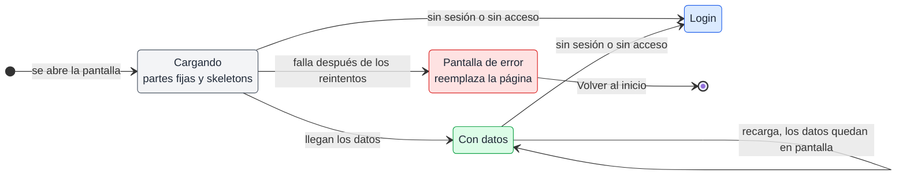
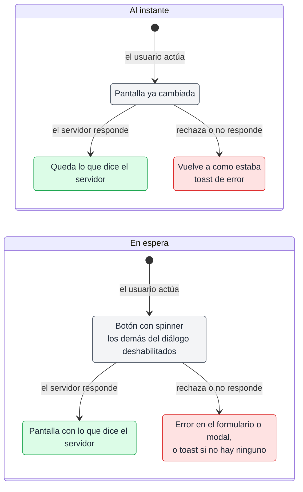

# Carga y acciones de la web

## 🔭 Resumen

La web dibuja cada pantalla en cuanto se abre, con las partes que no dependen del servidor, y pone un skeleton en cada parte que espera datos. Si la carga falla, una pantalla de error reemplaza la página; si el usuario no tiene sesión o perdió el acceso, la web lo lleva al login. Cada acción del usuario responde de una de dos formas: al instante, cambiando la pantalla antes de que conteste el servidor, o en espera, con su botón deshabilitado hasta la respuesta. Si falla una acción al instante, la pantalla vuelve atrás y aparece un toast; si falla una en espera, el error aparece en su formulario o modal, o en un toast cuando no tiene ninguno de los dos.

## ⏳ Cómo carga una pantalla

Al abrirse, una pantalla dibuja enseguida lo que no depende del servidor: los textos fijos, los títulos, el cuervo, las etiquetas y las pestañas. Un número que sale de los datos, como la cantidad de cada pestaña de filtro de Usuarios, no se muestra hasta que llegan. Cada tarjeta que espera datos se ve como un skeleton: un solo bloque gris, suave, con la forma y el tamaño de la tarjeta, sin nada adentro. Una tarjeta es la unidad que el usuario reconoce: la sesión destacada, cada card de una sección plegable, cada card de encuesta, cada fila de una lista, la slide, el nombre y el avatar del header. El skeleton nunca dibuja el contenido interno de una tarjeta, como sus textos, botones o íconos. La web trata el chequeo del login como un dato más de la pantalla que se abre. Mientras la web espera la respuesta, el nombre y el avatar del header se ven en skeleton. Cuando llegan los datos, cada parte los muestra. El aula del estudiante necesita la lista de sesiones para saber qué sesión abrir. Mientras la lista llega, el aula se dibuja en skeleton: el título del header, la slide con los controles de debajo, y el contenido de cada pestaña del panel, con las pestañas fijas.

Con datos en pantalla, una recarga deja en pantalla los datos anteriores, sin skeletons, hasta que llegan los datos nuevos. Así pasa con el pedido que la web repite cada cinco minutos (ver [componentes](componentes.md)) y con los que hace después de cada aviso del aula (ver [tiempo real del aula](tiempo-real-del-aula.md)).

La web reintenta una carga que falla dos veces. Si sigue fallando, la pantalla de error reemplaza la página entera y lleva al inicio. Es una sola pantalla para cualquier error. Un pedido que responde que el usuario no tiene sesión o perdió el acceso lleva al login, no a la pantalla de error (ver [login y acceso](login-y-acceso.md)).

Todo esto vale igual para el estudiante y para el profe, en las páginas, en los modales y en las pestañas del panel del aula.

## 👆 Cómo responde a una acción

Una acción al instante cambia la pantalla en cuanto el usuario actúa, antes de que responda el servidor. Cuando el servidor responde, la pantalla queda con los datos que devuelve el servidor. Una acción en espera deshabilita su botón y los demás botones de su diálogo, como Cancelar, hasta que el servidor responde. Su botón muestra un spinner. Mientras espera, el diálogo de confirmación no se cierra ni con Escape ni con un click afuera. Cuando el servidor responde, la pantalla muestra los datos que devuelve.

Qué forma toma cada acción depende de cómo la hace el usuario:

- **Al instante**: las acciones directas, un botón, un switch o un arrastre, sin confirmación ni formulario. Por ejemplo, habilitar una sesión, dar acceso a un usuario, levantar la mano, marcar una pregunta como respondida, activar o cerrar una encuesta, reordenar las sesiones o mover la slide.
- **En espera**: las acciones que pasan por un modal de confirmación, un formulario o un diálogo. Por ejemplo, borrar material, una encuesta o una sesión, sacar el acceso a un usuario, crear una sesión o una encuesta, subir un archivo, hacer una pregunta, votar una word cloud, que pasa por su campo de texto, o guardar el perfil.

Cerrar sesión es directa pero queda en espera, porque no cambia nada que se pueda deshacer en pantalla: la web espera la respuesta y va al login. Votar una encuesta de opción múltiple o de escala también queda en espera, como la word cloud. La opción elegida muestra un spinner hasta que responde el servidor y las demás opciones se deshabilitan. Si el voto falla, la opción vuelve a como estaba y aparece un toast. Marcar un HTML como slides sigue la revisión de las slides (ver [API de las slides](api-de-las-slides.md)).

> [!NOTE] Por qué la forma depende de cómo se hace la acción
> La regla busca que ninguna acción deje al usuario sin respuesta: lo directo se ve enseguida, y lo que ya pasó por una confirmación o un formulario muestra que está esperando.

Si el servidor rechaza una acción al instante o no responde, la pantalla vuelve a como estaba y aparece un toast de error. Si falla una acción en espera, el error aparece dentro de su formulario o modal, que quedan abiertos con lo que el usuario cargó. Cerrar sesión, que no tiene formulario ni modal, muestra el error en un toast. Cada acción define el texto de su toast. Una acción que recibe una respuesta de sin sesión o sin acceso lleva al login, igual que una carga.

## 🧩 Piezas compartidas

### ⌛ Botón en espera

Mientras su acción espera, el botón cambia su texto a un gerundio, como "Creando…" o "Borrando…", y muestra un spinner.

### 🔔 Toast

Un toast es una card con un ícono, el texto del error y una X para cerrarlo. Aparece abajo a la derecha; en el celular ocupa el ancho de la pantalla menos los márgenes. Si llegan varios, se apilan: el más nuevo queda abajo y empuja a los anteriores hacia arriba. Cada toast se cierra solo a los pocos segundos, o antes con su X.

### ⚠️ Pantalla de error

La pantalla de error no tiene header. Muestra el cuervo grande centrado, "No se pudo cargar la página", "Probá de nuevo en un rato." y el botón "Volver al inicio", que lleva al inicio del estudiante o al admin del profe.

[Prototipo de las piezas compartidas: el botón en espera, el toast y la pantalla de error](../prototipos/piezas.html)

---

Related: [componentes](componentes.md), [login y acceso](login-y-acceso.md), [tiempo real del aula](tiempo-real-del-aula.md), [API de las slides](api-de-las-slides.md), [estados de encuestas y sesiones](estados-de-encuestas-y-sesiones.md)
