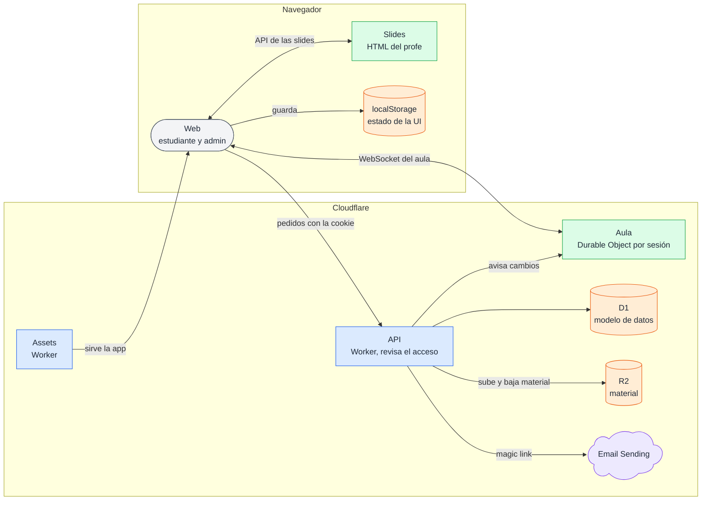

# Componentes

## 🔭 Resumen

Todo corre en Cloudflare. La web corre en el navegador. Las vistas del estudiante son responsive y las del admin son de escritorio; las dos comparten el header y el menú. La API es un Worker que atiende todos los pedidos de la web y revisa el acceso en cada uno. Cada sesión tiene un aula, un Durable Object que avisa al instante los cambios a quienes están conectados. Los datos viven en D1, los archivos del material en R2, y los magic links salen por Email Sending.

## 🏗️ Cómo se conectan las piezas

### 🌐 Web

Un Worker de assets sirve la web. En el navegador, la web pide todo a la API con la cookie del login y carga las slides de la sesión, un HTML del profe. La web habla con ese HTML por la API de las slides (ver [API de las slides](api-de-las-slides.md)). Mientras el usuario está en el aula, la web mantiene un WebSocket abierto con el aula de la sesión. Lo que no viene del servidor lo guarda en el localStorage del navegador.

La web y la API comparten el dominio `kurasu.asermax.com`: los pedidos a `/api` van al Worker de la API y el resto al Worker de assets. El navegador habla con un solo origen, y la cookie del login vale para los dos.

> [!TIP] La API en un dominio propio
> Se consideró y no se tomó. El login viaja en una cookie que el navegador manda solo al dominio que la dejó; con la API aparte, esa cookie tendría que compartirse entre subdominios y la API tendría que aceptar pedidos de origen cruzado, también los del WebSocket del aula.

La web vuelve a pedir sus datos a la API cada cinco minutos, en todas las pantallas. Fuera del aula no hay avisos: cada pantalla carga sus datos al abrirse y se actualiza con ese pedido. Así se ven, por ejemplo, un cambio de nombre o avatar, o una encuesta que el profe activa mientras el estudiante está en el inicio.

### ⚙️ API

La API es un Worker que atiende todos los pedidos de la web. Cada pedido lleva la cookie con el login, que dura una semana desde que se entra. En cada pedido, la API revisa que el usuario tenga acceso. Si no lo tiene, devuelve un error propio y la web manda al usuario al login (ver [login y acceso](login-y-acceso.md)). Guarda los datos en D1 con el [modelo de datos](modelo-de-datos.md), sube y baja los archivos del material en R2, y manda los magic links con Email Sending.

### 🏫 Aula

El aula de cada sesión es un Durable Object. Mientras el usuario está en el aula, la web tiene un WebSocket abierto con ella. La API le avisa al aula cada cambio que guarda, el aula se lo avisa a las webs conectadas, y cada web le vuelve a pedir a la API lo que cambió. Un deploy reinicia los Durable Objects y corta todas las conexiones del aula. Cómo viaja un cambio y qué pasa cuando se corta la conexión, también en un deploy, está en [tiempo real del aula](tiempo-real-del-aula.md).

### ✉️ Email Sending

Email Sending manda el mail con el magic link del registro y del login, desde `no-reply@kurasu.asermax.com`. Un usuario solo entra a la app con el link de ese mail.

> [!WARNING] Email Sending tiene requisitos propios
> Email Sending está en beta, necesita el plan pago de Workers y que el dominio esté en el DNS de Cloudflare. Sin eso no sale ningún mail, y nadie puede registrarse ni entrar.

## 🗄️ Estado que guarda el navegador

El navegador guarda en su localStorage lo que no viene del servidor: el modo oscuro, que vale para toda la app, y cómo dejó cada uno el aula (ver [tiempo real del aula](tiempo-real-del-aula.md)).

El estado queda en el navegador: quien entra después en la misma computadora lo hereda, y cerrar sesión no lo limpia.

---

Related: [modelo de datos](modelo-de-datos.md), [login y acceso](login-y-acceso.md), [tiempo real del aula](tiempo-real-del-aula.md), [API de las slides](api-de-las-slides.md)
