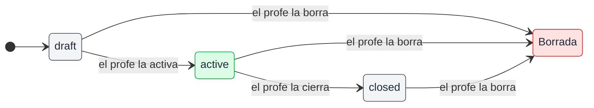
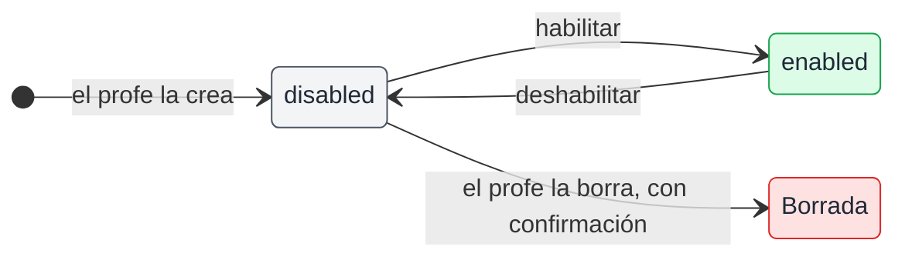
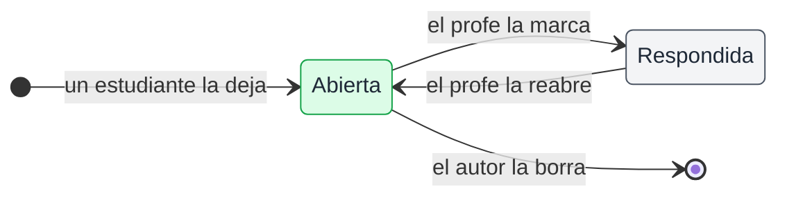

# Estados de encuestas y sesiones, y sus pantallas

## 🔭 Resumen

Una encuesta pasa de `draft` a `active` y de `active` a `closed`, y no vuelve atrás. Una sesión se habilita y se deshabilita desde su página, y solo una deshabilitada se borra. Una pregunta está abierta o respondida, y el profe la puede reabrir. Una encuesta o sesión borrada queda guardada con lo que cuelga de ella, con la fecha en que se borró en `deleted_at`, y nadie la ve (ver [modelo de datos](modelo-de-datos.md)).

## 📊 Encuesta

Una encuesta (`Poll`) se crea en el estado `draft`, un borrador que solo ve el profe y que puede editar. Existe recién cuando el profe la guarda como borrador. Las de tipo `choice` tienen su lista de opciones en `options`, y las de tipo `scale` un texto para el 1 en `scale_min_label` y otro para el 5 en `scale_max_label`; los campos del otro tipo quedan vacíos. Las de feedback no llevan más contenido que la consigna. La API rechaza y no guarda una encuesta que trae el contenido del otro tipo. Cuando la activa, pasa a `active` y los estudiantes la ven en la card de la sesión y en el aula, y votan; ven los resultados al votar, y pueden cambiar el voto mientras está activa. En el feedback el alumno responde con un emoji y un comentario en vez de votar, ve solo su propia respuesta y puede cambiarla mientras la encuesta sigue abierta (ver [feedback de una sesión](feedback-de-sesion.md)). Puede haber varias activas a la vez, y una activa no vuelve a borrador. Cuando el profe la cierra, pasa a `closed` y queda con sus resultados en el modal Encuestas de la sesión y en el aula, y no se reabre. Un feedback cerrado queda con la lista de sus respuestas en el modal, y el alumno ya no puede cambiarlas.

El profe puede borrar una encuesta en cualquier estado, con confirmación: queda guardada con sus respuestas, con la fecha en `deleted_at`, y nadie la ve. Si una activa tiene un error, el profe la borra y crea otra.

## 📚 Sesión

Una sesión (`Session`) se crea deshabilitada (`enabled` en falso), con título y resumen, al final de la lista del profe. Se habilita o se deshabilita solo desde su página. Deshabilitarla la saca de la vista del estudiante y saca a todos del aula, pero conserva todo lo que tiene: las encuestas activas, las manos levantadas y la posición del profe siguen ahí cuando se vuelve a habilitar. Solo una deshabilitada se borra, con confirmación; queda guardada con todo lo que cuelga de ella, con la fecha en `deleted_at`, y el profe vuelve a la lista de sesiones.

## ❓ Pregunta

Una pregunta (`Question`) está abierta o respondida, según su campo `answered`. Una pregunta respondida deja de verse para los estudiantes. El profe la ve al final, atenuada, y la puede reabrir; reabierta, los estudiantes la vuelven a ver. El estudiante borra las suyas, con confirmación. Los cambios de estado de encuestas y preguntas llegan al instante a quienes están en el aula (ver [tiempo real del aula](tiempo-real-del-aula.md)).

## 🏠 Inicio del estudiante

En el inicio, el estudiante ve solo las sesiones habilitadas, en el orden de la lista del profe. Arriba está la sesión destacada, la habilitada que está más adelante en la lista. Es la única desde la que se entra al aula; las demás están en "Sesiones anteriores". Cada card muestra el resumen, las encuestas activas, donde el estudiante vota o deja su feedback, y los links a Material, Encuestas y Preguntas, sin cantidades. Cada link abre un modal, que en celular es una hoja desde abajo y en escritorio va centrado. Cada card que se pliega muestra un caret, que apunta hacia abajo cuando está plegada y hacia arriba cuando está desplegada, como la lista de Presentes. Una sesión anterior muestra su material, sus encuestas cerradas y sus preguntas para leer, y en ella no se pregunta ni se vota.

Con `?sesion=<id>` en la URL, el inicio despliega la card de esa sesión entre las anteriores y hace scroll hasta dejarla en el centro de la pantalla. Es el link que lleva el mail de un anuncio (ver [novedades por mail](novedades-por-mail.md)). Si el id es el de la destacada, el de una sesión deshabilitada o borrada, o no existe, el inicio se ve como sin el parámetro. El parámetro queda en la URL, así que al recargar la card vuelve a desplegarse.

El inicio no recibe avisos: una encuesta que el profe activa o cierra aparece en el inicio cuando la web vuelve a pedir sus datos, cada cinco minutos, o cuando el estudiante vuelve a cargar la página (ver [componentes](componentes.md)).

[Prototipo del inicio del estudiante, en celular y escritorio](../prototipos/inicio-responsive.html)

## 🛠️ Admin de las sesiones

El profe ve la lista de sesiones, crea una nueva al final de la lista, las reordena arrastrándolas, y llega desde ahí a Usuarios (ver [login y acceso](login-y-acceso.md)). El número de una sesión es su posición en la lista.

[Prototipo de la lista de sesiones del profe](../prototipos/admin-sesiones.html)

La página de una sesión tiene las pestañas Contenido, Encuestas y Aula. En esa página, el profe habilita o deshabilita la sesión con el switch de su card, y una deshabilitada se borra desde la misma card. En Contenido edita el título y el resumen. El profe sube el material con un nombre desde un modal, y no lo puede reordenar ni renombrar. Borrar un material pide confirmación. La API rechaza una subida mal formada y no guarda ni el material ni el archivo. En Encuestas crea encuestas de cada tipo, edita los borradores, y activa, cierra y borra las encuestas. Sin encuestas, la pestaña muestra "Todavía no hay encuestas" debajo del creador. En el panel del aula el profe solo activa y cierra encuestas. La pestaña Aula está en [tiempo real del aula](tiempo-real-del-aula.md), y la subida de las slides en [API de las slides](api-de-las-slides.md).

[Prototipo del admin de una sesión, con sus pestañas Contenido, Encuestas y Aula](../prototipos/admin-sesion.html)

---

Related: [modelo de datos](modelo-de-datos.md), [tiempo real del aula](tiempo-real-del-aula.md), [login y acceso](login-y-acceso.md), [API de las slides](api-de-las-slides.md), [carga y acciones de la web](carga-y-acciones-de-la-web.md), [novedades por mail](novedades-por-mail.md), [feedback de una sesión](feedback-de-sesion.md)
