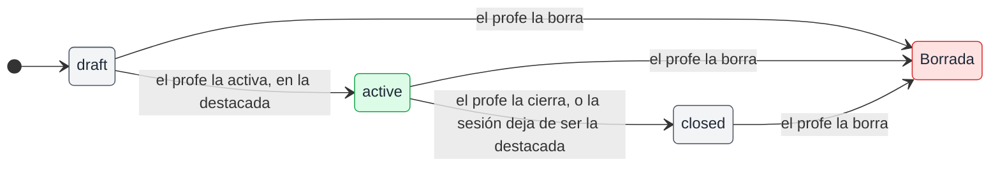
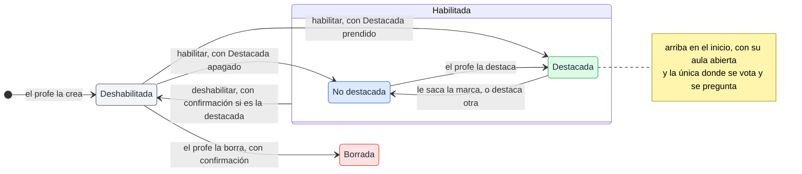
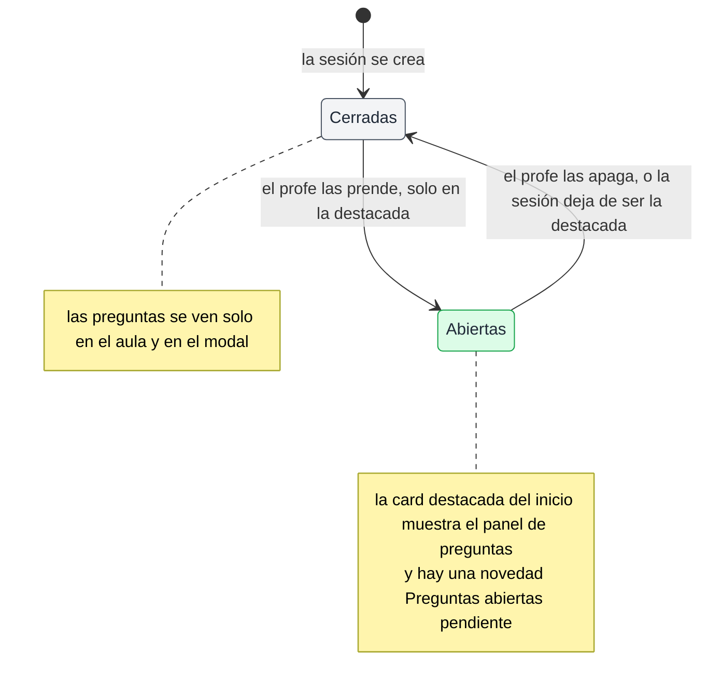
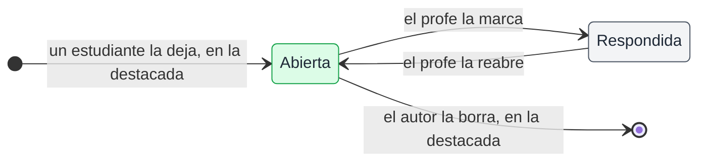

# Estados de encuestas y sesiones, y sus pantallas

## 🔭 Resumen

Una encuesta pasa de `draft` a `active` y de `active` a `closed`, y no vuelve atrás. Una sesión se habilita y se deshabilita desde su página, y solo una deshabilitada se borra. Una habilitada está destacada o no, y hay a lo sumo una destacada, que marca el profe. Las preguntas destacadas de una sesión están cerradas o abiertas, y abiertas muestran sus preguntas en la card destacada del inicio. Una pregunta está abierta o respondida, y el profe la puede reabrir. Una encuesta o sesión borrada queda guardada con lo que cuelga de ella, con la fecha en que se borró en `deleted_at`, y nadie la ve (ver [modelo de datos](modelo-de-datos.md)).

## 📊 Encuesta

Una encuesta (`Poll`) se crea en el estado `draft`, un borrador que solo ve el profe y que puede editar. Existe recién cuando el profe la guarda como borrador. Las de tipo `choice` tienen su lista de opciones en `options`, y las de tipo `scale` un texto para el 1 en `scale_min_label` y otro para el 5 en `scale_max_label`; los campos del otro tipo quedan vacíos. Las de feedback no llevan más contenido que la consigna. La API rechaza y no guarda una encuesta que trae el contenido del otro tipo. Solo se activa en la sesión destacada, y fuera de ella el botón Activar no aparece. Cuando la activa, pasa a `active` y los estudiantes la ven en la card de la sesión y en el aula, y votan; ven los resultados al votar, y pueden cambiar el voto mientras está activa. En el feedback el alumno responde con un emoji y un comentario en vez de votar, ve solo su propia respuesta y puede cambiarla mientras la encuesta sigue abierta (ver [feedback de una sesión](feedback-de-sesion.md)). Puede haber varias activas a la vez, y una activa no vuelve a borrador. Cuando el profe la cierra, o cuando la sesión deja de ser la destacada, pasa a `closed` y queda con sus resultados en el modal Encuestas de la sesión y en el aula, y no se reabre. Un feedback cerrado queda con la lista de sus respuestas en el modal, y el alumno ya no puede cambiarlas.

El profe puede borrar una encuesta en cualquier estado, con confirmación: queda guardada con sus respuestas, con la fecha en `deleted_at`, y nadie la ve. Si una activa tiene un error, el profe la borra y crea otra.

## 📚 Sesión

Una sesión (`Session`) se crea deshabilitada (`enabled` en falso), con título y resumen, al final de la lista del profe. Se habilita o se deshabilita solo desde su página. Una habilitada está destacada o no destacada, según su marca `featured`, y hay a lo sumo una destacada. Habilitarla con el switch "Destacada" del modal prendido la lleva directo a destacada. La destacada es la que el estudiante ve arriba en su inicio, la única con el aula abierta y la única donde los estudiantes votan, preguntan y levantan la mano.

Una sesión deja de ser la destacada cuando el profe le saca la marca, cuando destaca otra o cuando la deshabilita, y las tres acciones piden confirmación. Al dejar de serlo, la API cierra sus encuestas activas, el feedback incluido, baja sus manos levantadas y apaga sus preguntas destacadas, en el mismo pedido que cambia la marca (ver [acceso a datos](acceso-a-datos.md)). Sus preguntas sin responder y la posición del profe en las slides quedan como están, y la web lleva al inicio a los estudiantes que estaban en el aula de esa sesión (ver [tiempo real del aula](tiempo-real-del-aula.md)).

Deshabilitar una sesión la saca de la vista del estudiante, y si era la destacada deja de serlo. Deshabilitar una que no es la destacada conserva todo lo que tiene: sus encuestas, sus preguntas y la posición del profe siguen ahí cuando se vuelve a habilitar. Solo una deshabilitada se borra, así que la destacada no se borra. Borrar pide confirmación; la sesión queda guardada con todo lo que cuelga de ella, con la fecha en `deleted_at`, y el profe vuelve a la lista de sesiones.

## ⭐ Preguntas destacadas

Las preguntas destacadas de una sesión, en `featured_questions`, están cerradas o abiertas. Arrancan cerradas, y el profe las abre y las cierra con el switch "Preguntas destacadas" del panel del aula. Solo se abren en la destacada, y se cierran solas cuando la sesión deja de ser la destacada, así que en una sesión no destacada siempre están cerradas. Abrirlas crea la novedad "Preguntas abiertas", y cerrarlas la saca (ver [novedades por mail](novedades-por-mail.md)). Abiertas, la card destacada del inicio muestra el panel de preguntas. En el aula se pregunta con ellas abiertas o cerradas.

## ❓ Pregunta

Una pregunta (`Question`) está abierta o respondida, según su campo `answered`. Una pregunta respondida deja de verse para los estudiantes. El profe la ve al final, atenuada, y la puede reabrir; reabierta, los estudiantes la vuelven a ver. El estudiante borra las suyas, con confirmación. Preguntar, votar una pregunta y borrar la propia se hacen solo en la sesión destacada, desde el aula o desde su card en el inicio. Los cambios de estado de encuestas y preguntas llegan al instante a quienes están en el aula (ver [tiempo real del aula](tiempo-real-del-aula.md)).

## 🏠 Inicio del estudiante

En el inicio, el estudiante ve solo las sesiones habilitadas, en el orden de la lista del profe. Arriba está la sesión destacada, la que tiene la marca. Es la única desde la que se entra al aula. Debajo, "Otras sesiones" lista todas las demás habilitadas en el orden del profe, también las que vienen después de la destacada. Al costado de esa lista, un camino une un círculo por sesión: las sesiones anteriores a la destacada llevan el check de terminada, y las que vienen después no llevan check ni número. Cada card muestra el resumen, las encuestas activas, donde el estudiante vota o deja su feedback, y los links a Material, Encuestas y Preguntas, sin cantidades. Cada link abre un modal, que en celular es una hoja desde abajo y en escritorio va centrado. Cada card que se pliega muestra un caret, que apunta hacia abajo cuando está plegada y hacia arriba cuando está desplegada, como la lista de Presentes. Una sesión de "Otras sesiones" muestra su material, sus encuestas cerradas y sus preguntas para leer, y en ella no se pregunta ni se vota.

Con las preguntas destacadas abiertas, la card destacada muestra el panel de preguntas arriba de las encuestas activas: el campo para preguntar, las tres preguntas más votadas y las del estudiante, en orden de votos. "Mostrar N preguntas más", debajo de la última, despliega la lista completa dentro de la card, y "Mostrar menos" la vuelve a plegar. Sin preguntas, el panel muestra el campo y "Todavía no hay preguntas. Hacé la primera.". Las respondidas no aparecen. El estudiante pregunta, vota y borra las suyas con confirmación, con los mismos pedidos que usa el aula, y después de cada acción la web vuelve a pedir la lista. La card también tiene el link Preguntas, que abre el modal con la lista completa.

Sin destacada, el inicio no muestra la card de arriba: muestra solo la lista, titulada "Sesiones", con todas las habilitadas y sin check ni número en el camino, y nadie entra a ningún aula.

Con `?sesion=<id>` en la URL, el inicio despliega la card de esa sesión entre las otras sesiones y hace scroll hasta dejarla en el centro de la pantalla. Es el link que lleva el mail de un anuncio (ver [novedades por mail](novedades-por-mail.md)). Si el id es el de la destacada, el de una sesión deshabilitada o borrada, o no existe, el inicio se ve como sin el parámetro. El parámetro queda en la URL, así que al recargar la card vuelve a desplegarse.

La lista de sesiones trae, en cada una, si es la destacada y si tiene las preguntas destacadas abiertas, y la web toma la destacada de esa marca. La web pide las encuestas activas de la destacada y, si tiene las preguntas destacadas abiertas, sus preguntas.

El inicio no recibe avisos: una encuesta que el profe activa o cierra, un cambio de destacada y las preguntas de los demás aparecen en el inicio cuando la web vuelve a pedir sus datos, cada cinco minutos, o cuando el estudiante vuelve a cargar la página (ver [componentes](componentes.md)).

[Prototipo del inicio del estudiante, en celular y escritorio](../prototipos/inicio-responsive.html)

## 🛠️ Admin de las sesiones

El profe ve la lista de sesiones, crea una nueva al final de la lista, las reordena arrastrándolas, y llega desde ahí a Usuarios (ver [login y acceso](login-y-acceso.md)). El número de una sesión es su posición en la lista. La destacada lleva el chip "Destacada".

[Prototipo de la lista de sesiones del profe](../prototipos/admin-sesiones.html)

La página de una sesión tiene las pestañas Contenido, Encuestas y Aula. En esa página, el profe habilita o deshabilita la sesión con el switch de su card, y una deshabilitada se borra desde la misma card. Debajo del switch de habilitar está el switch "Destacada", que se prende solo con la sesión habilitada. En Contenido edita el título y el resumen. El profe sube el material con un nombre desde un modal, y no lo puede reordenar ni renombrar. Borrar un material pide confirmación. La API rechaza una subida mal formada y no guarda ni el material ni el archivo. En Encuestas crea encuestas de cada tipo, edita los borradores, y activa, cierra y borra las encuestas. Sin encuestas, la pestaña muestra "Todavía no hay encuestas" debajo del creador. Fuera de la destacada, el botón Activar no aparece, y debajo de los borradores una línea dice "Solo se activan encuestas en la sesión destacada.". En el panel del aula el profe solo activa y cierra encuestas, con la misma regla para Activar. En la pestaña Preguntas del panel, arriba de la lista, el switch "Preguntas destacadas" abre y cierra las preguntas destacadas, y fuera de la destacada está deshabilitado. La pestaña Aula está en [tiempo real del aula](tiempo-real-del-aula.md), y la subida de las slides en [API de las slides](api-de-las-slides.md).

Habilitar una sesión abre un modal con el switch "Destacada", prendido por defecto. Si el switch está prendido y otra sesión es la destacada, el modal avisa que esa sesión deja de serlo y dice cuántas de sus encuestas activas se cierran y cuántas manos se bajan. Ese aviso es la confirmación: Habilitar habilita y destaca en un solo pedido. La confirmación de destacar la sesión cuando otra es la destacada, de sacarle la marca a la destacada y de deshabilitar la destacada también dice cuántas encuestas se cierran y cuántas manos se bajan. Para contarlas, la web toma la destacada de la lista de sesiones y pide sus encuestas y sus manos con los mismos pedidos que usa la página de esa sesión. Las cuatro acciones quedan en espera hasta que responde la API, y si fallan, el error aparece dentro del diálogo, que sigue abierto (ver [carga y acciones de la web](carga-y-acciones-de-la-web.md)).

[Prototipo del admin de una sesión, con sus pestañas Contenido, Encuestas y Aula](../prototipos/admin-sesion.html)

---

Related: [modelo de datos](modelo-de-datos.md), [tiempo real del aula](tiempo-real-del-aula.md), [login y acceso](login-y-acceso.md), [API de las slides](api-de-las-slides.md), [carga y acciones de la web](carga-y-acciones-de-la-web.md), [novedades por mail](novedades-por-mail.md), [feedback de una sesión](feedback-de-sesion.md)
