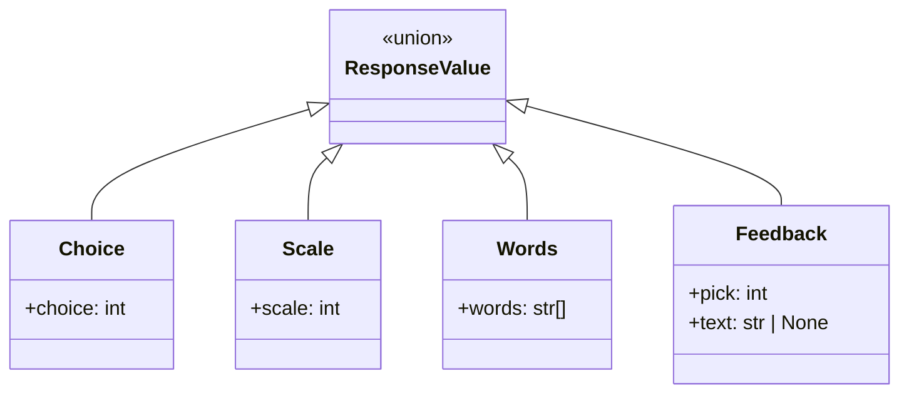
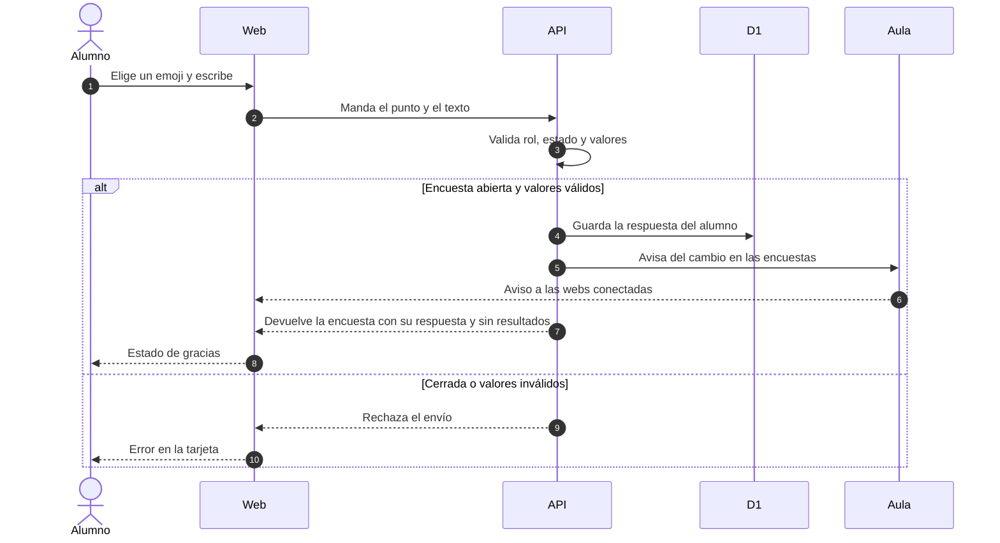
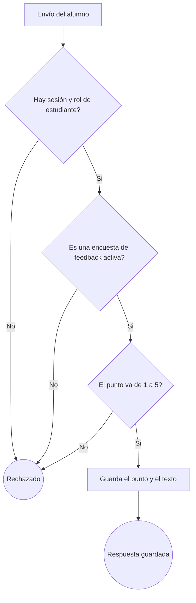
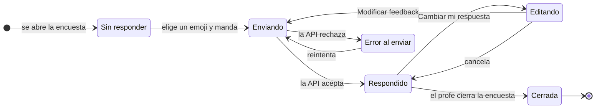
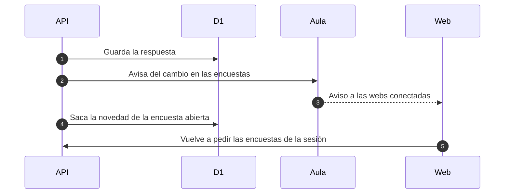

# Feedback de una sesión

## 🔭 Resumen

El feedback es una encuesta de la sesión con un tipo propio. El alumno elige un puntaje de 1 a 5 entre cinco emojis y, si quiere, escribe un comentario libre. No ve resultados de nadie: ve su propia respuesta y puede cambiarla mientras la encuesta sigue abierta. El profe ve todas las respuestas con el nombre y el avatar de cada alumno, en un modal.

Comparte con las otras encuestas la entidad, el ciclo de estados, la novedad y el aviso al aula. Lo que cambia es lo que se guarda, quién ve qué y qué muestra cada pantalla.

## 💽 Qué guarda una respuesta

La encuesta no suma columnas: usa la encuesta que ya existe, con el tipo `feedback` y la consigna en su pregunta. Lo que cambia es el valor de la respuesta, que es una unión con una rama por tipo.

El punto se guarda como número de 1 a 5, no como el emoji que se toca. El texto es opcional, y cuando el alumno no escribe nada la clave no está en el valor, igual que los campos que no aplican a los otros tipos. El texto se guarda tal como lo escribió, sin recortar.

> [!NOTE] Por qué el puntaje es un número y no el emoji
> Los emojis de la pantalla pueden cambiar y el número no cambia de significado. Guardado el punto, un cambio de emojis no reinterpreta lo que ya contestaron los alumnos.

## 📩 Cómo llega una respuesta

El envío reemplaza la respuesta anterior del mismo alumno: hay una por alumno y por encuesta, y volver a mandarla cambia el valor que ya estaba. La respuesta que vuelve trae la encuesta con lo que el alumno mandó y sin resultados, así que la pantalla pasa al estado de gracias sin esperar otra lectura.

Del lado del profe, la lectura trae todas las respuestas de la encuesta con el nombre y el avatar de cada alumno.

## ⚖️ Las reglas del envío

La API acepta el envío solo de un estudiante, sobre una encuesta de tipo feedback y activa, con un punto entre 1 y 5. El texto es opcional y no tiene tope: si llega vacío o no llega, la respuesta se guarda con el punto solo.

Mientras la encuesta está abierta el alumno puede reemplazar su respuesta, y cuando el profe la cierra ya no. La web aplica las mismas reglas antes de mandar el pedido, y el backend manda. Un envío rechazado no guarda nada.

## 🟢 Los estados de la tarjeta

Sin responder, la tarjeta muestra los cinco emojis, el campo de texto y el botón de envío, que queda deshabilitado hasta que el alumno elige un emoji. Al enviar, el botón muestra que espera y los emojis se deshabilitan.

Respondido, la tarjeta agradece el envío y muestra el emoji elegido y el texto debajo, con el enlace "Cambiar mi respuesta". Editando, vuelve el formulario con lo que había mandado y el botón dice "Modificar feedback". En el estado de error, la tarjeta muestra la alerta de error de la app y conserva lo que el alumno cargó.

Cerrada, la tarjeta muestra solo la respuesta del alumno y ya no ofrece cambiarla.

## 🖥️ La tarjeta del alumno y la del profe

[Prototipo de la tarjeta del alumno, con sus seis estados](../prototipos/feedback-sesion.html)

En la card de la sesión, la tarjeta del feedback ocupa el lugar de las encuestas, debajo de las que están activas. En el aula aparece como cualquier encuesta activa.

Del lado del profe, la tarjeta vive en la pestaña Encuestas y se abre, se cierra y se borra como cualquier encuesta. Muestra el total de respuestas y el reparto en las cinco barras de la encuesta de escala, con el emoji debajo de cada barra. Un botón abre un modal que solo lista las respuestas, cada una con el nombre, el emoji y el texto.

[Prototipo de la tarjeta del profe y su modal, con las respuestas de una sesión](../prototipos/admin-feedback.html)

La lista se ordena por el id de la respuesta. Ese id no cambia cuando el alumno edita su respuesta, así que el orden es el de la primera vez que cada alumno respondió, y no hace falta guardar cuándo se envió.

## 🔔 Lo que pasa después de guardar

Guardar una respuesta avisa al aula de la sesión, y las webs conectadas vuelven a pedir las encuestas. También saca la novedad pendiente de la encuesta abierta, así el profe no la anuncia después de que alguien respondió.

---

Related: [modelo de datos](modelo-de-datos.md), [estados de encuestas y sesiones](estados-de-encuestas-y-sesiones.md), [acceso a datos](acceso-a-datos.md), [carga y acciones de la web](carga-y-acciones-de-la-web.md), [tiempo real del aula](tiempo-real-del-aula.md), [novedades por mail](novedades-por-mail.md)
