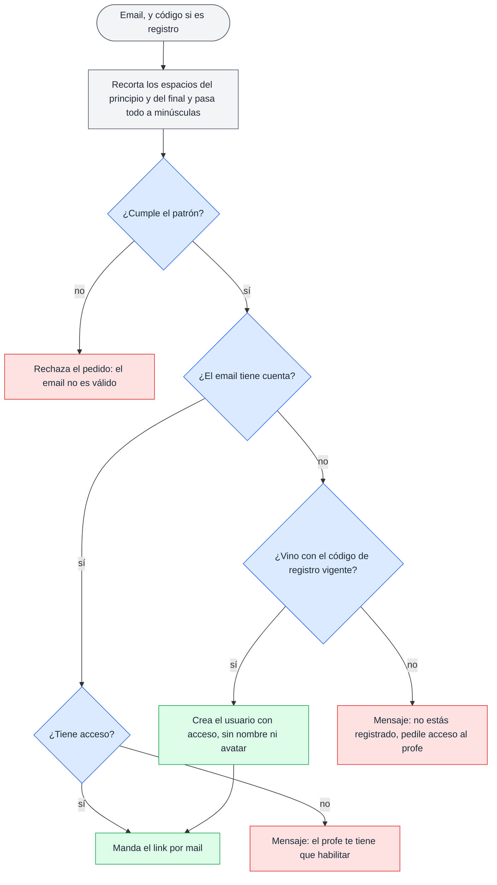
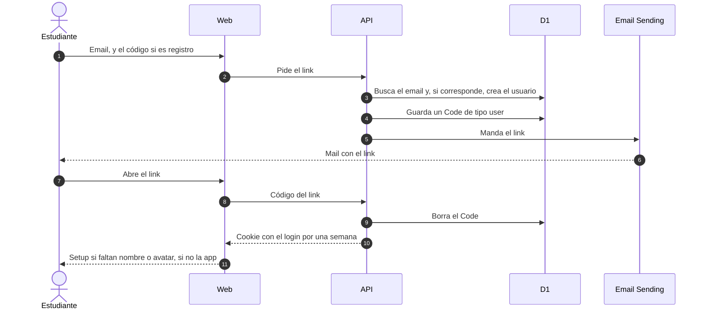

# Login y acceso

## 🔭 Resumen

Nadie tiene contraseña. El registro y el login terminan en un link que llega por mail, sirve una sola vez y deja una cookie con el login por una semana. El registro funciona como el login, con el código de registro además del email, que el estudiante escribe o trae puesto desde el QR. Registrarse con un código vigente da acceso; después, solo el profe da y saca el acceso, desde Usuarios. La API revisa el acceso en cada pedido, y sin acceso la web vuelve al login.

## ⚖️ Qué pasa con el email

El estudiante se registra en la pantalla del código: lo escribe, o el QR la abre con el código puesto, y después escribe su email. Para entrar, escribe solo su email en la pantalla de login. En los dos casos la API decide con el email y el código, si vino uno:

Antes de buscar la cuenta, la API controla que el email sea válido. La regla recorta los espacios del principio y del final y pasa todo el email a minúsculas. Después controla que cumpla un patrón. La parte antes de la @ son letras, dígitos y `_ ' + -`, en tramos separados por un solo punto, sin punto al principio ni al final. El dominio son tramos de letras, dígitos y guiones separados por puntos, con al menos un punto, y termina en dos o más letras. Así, `ezequiel.pastore.@mi.unc.edu.ar`, `.juan@x.com`, `juan..perez@x.com`, `juan@localhost` y `juan perez@x.com` son inválidos, y `juan+kurasu@gmail.com` y `x@mi.unc.edu.ar` son válidos.

Con un email inválido, la API rechaza el pedido y no manda el mail. El email que sale de la regla, recortado y en minúsculas, es el que la API usa para buscar la cuenta y el que guarda, así que `Juan@X.com` y `juan@x.com` son la misma cuenta. La web controla el email con la misma regla antes de mandar el pedido (ver [carga y acciones de la web](carga-y-acciones-de-la-web.md)).

Un email válido igual puede rebotar y quedar suprimido, y entonces Email Sending lo saca de las tandas del anuncio de novedades (ver [novedades por mail](novedades-por-mail.md)).

> [!NOTE] Por qué este patrón
> Email Sending rechaza un mail entero cuando una de sus direcciones tiene formato inválido, como `ezequiel.pastore.@mi.unc.edu.ar`, con un punto justo antes de la @, y el error no dice cuál fue. El patrón rechaza esas direcciones antes de que entren a kurasu, y acepta las que usan los estudiantes, con un `+` antes de la @ o con un dominio de varios tramos como `mi.unc.edu.ar`.

Si el email tiene cuenta con acceso, el registro sigue como un login y le llega el link. Si la cuenta no tiene acceso, la web muestra el mensaje de que el profe lo tiene que habilitar, y la API no manda el mail. Si el email no tiene cuenta y vino con el código de registro vigente, la API crea un `User` con `has_access` en verdadero y sin `name` ni `avatar`, y desde ese momento el profe lo ve en Usuarios con su email. Si no tiene cuenta ni código, como pasa en el login, el mensaje dice que no está registrado y que le pida acceso al profe, y la API tampoco manda el mail. La API compara el código de registro sin distinguir mayúsculas de minúsculas, así que un código escrito en minúsculas también vale.

> [!NOTE] Por qué registrarse no devuelve el acceso
> Registrarse otra vez con el QR no le devuelve el acceso a quien el profe se lo sacó: solo el profe da y saca el acceso, desde Usuarios.

[Prototipo de las pantallas del registro y sus mensajes, en celular y escritorio](../prototipos/registro-responsive.html)

## 📩 Del link del mail a la cookie

Antes de pedir el link (2), la web controla el email con la regla de arriba, como controla los campos de cualquier formulario (ver [carga y acciones de la web](carga-y-acciones-de-la-web.md)). Si el estudiante aprieta "Mandame el link" con un email inválido, el error de un campo dice "El email ingresado no es válido." y aparece debajo del campo del email. El botón está habilitado mientras haya texto en el campo. Los mensajes de la API, como el de que no está registrado, aparecen como error del formulario debajo del botón.

> [!NOTE] Por qué el error del campo espera al botón
> Mientras el estudiante escribe, el email está incompleto y no cumple la regla; un error desde la primera tecla marcaría como inválido un email que el estudiante todavía no terminó de escribir. Después del primer envío fallido, el estudiante está corrigiendo, y como la web revisa el email con cada tecla, el error se va apenas el email es válido.

[Prototipo del error de un campo con un email inválido, en la pantalla del email y en la hoja "Agregar por email" del profe](../prototipos/aviso-email.html)

El estudiante escribe su email, y el código si se está registrando (1), y la web le pide el link a la API (2). La API busca el email y aplica las reglas de arriba; si el email es nuevo y el código es el vigente, crea el usuario (3). Guarda el código del link, una fila de `Code` de tipo `user` con el `user_id` del usuario, que reemplaza a la que tuviera (4), y lo manda por mail (5, 6). El mail lleva solo el link, y el usuario no tiene que tipear el código del link. El anuncio de novedades que manda el profe es un mail aparte (ver [novedades por mail](novedades-por-mail.md)). El link abre la web del mismo entorno que lo mandó: en producción, el dominio de la app; en desarrollo, la web local. Si el mail no sale, la web muestra un error y el código queda guardado; pedir el link otra vez manda uno nuevo, que reemplaza al anterior.

Cuando el usuario abre el link (7, 8), la API borra el código y deja una cookie con el login por una semana (9, 10). Como la API borra el código, el link sirve una sola vez; mientras no se usa, no vence. Si al usuario le faltan nombre o avatar, la web lo lleva al setup antes de entrar (11): ahí elige su nombre y un emoji de animal. Esto vale para cualquier entrada, así que alguien que el profe agregó por email también pasa por el setup la primera vez. El profe entra directo al admin.

Cada usuario, también el profe, edita después su nombre y su avatar desde el modal "Tu perfil" del menú. El cambio les llega a los demás cuando su web vuelve a pedir sus datos, cada cinco minutos, no por el aula (ver [componentes](componentes.md)).

## 🍪 Acceso en cada pedido

La cookie lleva un JWT con el login. Dura una semana desde que se entra, y usar la app no la renueva: a la semana, el usuario vuelve a pedir un link.

En cada pedido, la API revisa el campo `has_access` del usuario. Si está en falso, devuelve un error propio y la web lo manda al login. Así, si el profe le saca el acceso a alguien que tiene la app abierta, esa persona vuelve al login en su próximo pedido al servidor. Cerrar sesión borra la cookie y vuelve al login.

El WebSocket del aula revisa el acceso una sola vez, al abrirse; qué pasa con quien pierde el acceso con el aula abierta está en [tiempo real del aula](tiempo-real-del-aula.md).

Al abrir una pantalla, la web chequea el login como un dato más de esa pantalla. Mientras espera la respuesta, la pantalla se dibuja con sus partes fijas y sus skeletons. Si no hay sesión, la web va al login (ver [carga y acciones de la web](carga-y-acciones-de-la-web.md)).

## 👥 Usuarios

El profe administra los usuarios desde la pantalla Usuarios, a la que llega desde la lista de sesiones. Ahí busca, filtra por acceso, da y saca el acceso y agrega usuarios por email. Los usuarios no se borran: el profe le saca el acceso a quien no tiene que entrar. Un usuario agregado por email ya tiene acceso. Mientras un usuario no tiene nombre ni avatar, la lista lo muestra con placeholders en gris: un círculo con borde punteado y un "?" en lugar del avatar, y "Sin nombre" en lugar del nombre. El email va en la segunda línea, como en los usuarios con perfil. El usuario del profe, con `role` en `teacher`, se crea a mano.

La hoja "Agregar por email" controla el email con la misma regla que la pantalla del email. Si el profe aprieta "Agregar" con un email inválido, el error de un campo dice "El email ingresado no es válido." debajo del campo, como se explica en [carga y acciones de la web](carga-y-acciones-de-la-web.md). La API aplica la regla de nuevo al recibir el pedido, y con el email recortado y en minúsculas controla que no esté repetido y guarda el usuario. Si el email ya tiene cuenta, la hoja muestra "Ese email ya está registrado." como error del formulario, antes de sus botones. La app no tiene forma de editar un email ya guardado.

El QR de registro y su código están uno junto al otro. El QR abre la pantalla de registro de la web, con el código puesto, en el mismo entorno que el link del mail. El código es una fila de `Code` sin `user_id`, de cinco caracteres para que se pueda escribir a mano. La app lo genera la primera vez que el profe abre el QR, y el profe lo regenera con un botón: el anterior deja de servir para registrarse. Sacarle el acceso a alguien y regenerar el código piden confirmación, como toda acción destructiva (ver [carga y acciones de la web](carga-y-acciones-de-la-web.md)). El profe no se puede sacar el acceso a sí mismo: la API lo rechaza, porque no habría otro profe que se lo devuelva. Cómo se guardan los dos tipos de código está en el [modelo de datos](modelo-de-datos.md).

[Prototipo de la pantalla Usuarios del profe, con el QR y el código de registro](../prototipos/admin-usuarios.html)

---

Related: [modelo de datos](modelo-de-datos.md), [componentes](componentes.md), [tiempo real del aula](tiempo-real-del-aula.md), [estados de encuestas y sesiones](estados-de-encuestas-y-sesiones.md), [carga y acciones de la web](carga-y-acciones-de-la-web.md), [novedades por mail](novedades-por-mail.md)
