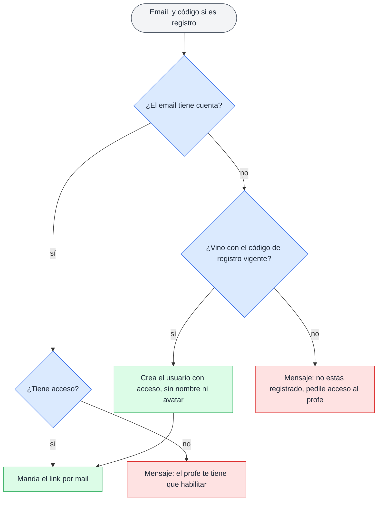
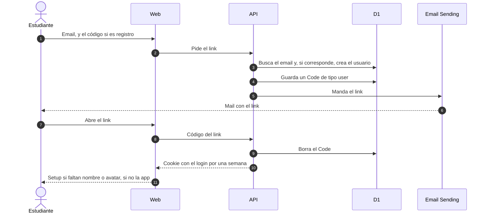

# Login y acceso

## 🔭 Resumen

Nadie tiene contraseña. El registro y el login terminan en un link que llega por mail, sirve una sola vez y deja una cookie con el login por una semana. El registro funciona como el login, con el código de registro además del email, que el estudiante escribe o trae puesto desde el QR. Registrarse con un código vigente da acceso; después, solo el profe da y saca el acceso, desde Usuarios. La API revisa el acceso en cada pedido, y sin acceso la web vuelve al login.

## ⚖️ Qué pasa con el email

El estudiante se registra en la pantalla del código: lo escribe, o el QR la abre con el código puesto, y después escribe su email. Para entrar, escribe solo su email en la pantalla de login. En los dos casos la API decide con el email y el código, si vino uno:

Si el email tiene cuenta con acceso, el registro sigue como un login y le llega el link. Si la cuenta no tiene acceso, la web muestra el mensaje de que el profe lo tiene que habilitar, y la API no manda el mail. Si el email no tiene cuenta y vino con el código de registro vigente, la API crea un `User` con `has_access` en verdadero y sin `name` ni `avatar`, y desde ese momento el profe lo ve en Usuarios con su email. Si no tiene cuenta ni código, como pasa en el login, el mensaje dice que no está registrado y que le pida acceso al profe, y la API tampoco manda el mail.

> [!NOTE] Por qué registrarse no devuelve el acceso
> Registrarse otra vez con el QR no le devuelve el acceso a quien el profe se lo sacó: solo el profe da y saca el acceso, desde Usuarios.

[Prototipo de las pantallas del registro y sus mensajes, en celular y escritorio](../prototipos/registro-responsive.html)

## 📩 Del link del mail a la cookie

El estudiante escribe su email, y el código si se está registrando (1), y la web le pide el link a la API (2). La API busca el email y aplica las reglas de arriba; si el email es nuevo y el código es el vigente, crea el usuario (3). Guarda el código del link, una fila de `Code` de tipo `user` con el `user_id` del usuario, que reemplaza a la que tuviera (4), y lo manda por mail (5, 6). El mail lleva solo el link, y el usuario no tiene que tipear el código del link.

Cuando el usuario abre el link (7, 8), la API borra el código y deja una cookie con el login por una semana (9, 10). Como la API borra el código, el link sirve una sola vez; mientras no se usa, no vence. Si al usuario le faltan nombre o avatar, la web lo lleva al setup antes de entrar (11): ahí elige su nombre y un emoji de animal. Esto vale para cualquier entrada, así que alguien que el profe agregó por email también pasa por el setup la primera vez. El profe entra directo al admin.

Cada usuario, también el profe, edita después su nombre y su avatar desde el modal "Tu perfil" del menú. El cambio les llega a los demás cuando su web vuelve a pedir sus datos, cada cinco minutos, no por el aula (ver [componentes](componentes.md)).

## 🍪 Acceso en cada pedido

La cookie lleva un JWT con el login. Dura una semana desde que se entra, y usar la app no la renueva: a la semana, el usuario vuelve a pedir un link.

En cada pedido, la API revisa el campo `has_access` del usuario. Si está en falso, devuelve un error propio y la web lo manda al login. Así, si el profe le saca el acceso a alguien que tiene la app abierta, esa persona vuelve al login en su próximo pedido al servidor. Cerrar sesión borra la cookie y vuelve al login.

El WebSocket del aula revisa el acceso una sola vez, al abrirse; qué pasa con quien pierde el acceso con el aula abierta está en [tiempo real del aula](tiempo-real-del-aula.md).

## 👥 Usuarios

El profe administra los usuarios desde la pantalla Usuarios, a la que llega desde la lista de sesiones. Ahí busca, filtra por acceso, da y saca el acceso y agrega usuarios por email. Los usuarios no se borran: el profe le saca el acceso a quien no tiene que entrar. Un usuario agregado por email ya tiene acceso, y aparece solo con su email hasta que hace el setup. El usuario del profe, con `role` en `teacher`, se crea a mano.

El QR de registro y su código están uno junto al otro. El código es una fila de `Code` sin `user_id`. La app lo genera la primera vez que el profe abre el QR, y el profe lo regenera con un botón: el anterior deja de servir para registrarse. Sacarle el acceso a alguien y regenerar el código piden confirmación, como toda acción destructiva (ver [estados de encuestas y sesiones](estados-de-encuestas-y-sesiones.md)). Cómo se guardan los dos tipos de código está en el [modelo de datos](modelo-de-datos.md).

[Prototipo de la pantalla Usuarios del profe, con el QR y el código de registro](../prototipos/admin-usuarios.html)

---

Related: [modelo de datos](modelo-de-datos.md), [componentes](componentes.md), [tiempo real del aula](tiempo-real-del-aula.md), [estados de encuestas y sesiones](estados-de-encuestas-y-sesiones.md)
