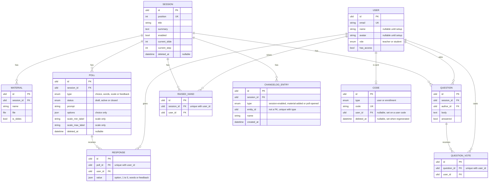

# Modelo de datos

## 🔭 Resumen

La app guarda usuarios, sesiones y lo que cuelga de cada sesión: su material, sus encuestas con sus respuestas, sus preguntas con sus votos, las manos levantadas, la slide en la que está el profe y las novedades que el profe todavía no anunció. Todo vive en D1, salvo los archivos del material, que viven en R2 (ver [componentes](componentes.md)). Las sesiones y las encuestas quedan guardadas al borrarse: cada una guarda en `deleted_at` la fecha en que se borró, conserva lo que cuelga de ella y nadie la ve. Un código de registro regenerado también queda guardado, con la fecha en `deleted_at`. Un material, una pregunta propia o una novedad se borran definitivamente, el código de un link se borra al usarse y una mano se baja. Los códigos de registro y los de los links del mail son filas de la misma entidad, `Code`. Cada entidad tiene su propio id ULID, también las que unen dos entidades, como una respuesta o una mano levantada. Ese id nunca queda vacío. Cómo la API lee y escribe estas entidades está en [acceso a datos](acceso-a-datos.md).

## 💽 Entidades y relaciones

### 👤 Usuario

La entidad `User` tiene `email`, `name`, `avatar`, `role` y `has_access`. El usuario entra con su email, que es único. La API lo guarda recortado y en minúsculas, y solo si cumple la regla del email (ver [login y acceso](login-y-acceso.md)). El avatar es un animal de una lista fija, guardado como su clave en inglés, por ejemplo `fox`; la web lo muestra con su emoji y lo busca por su nombre en español. El nombre y el avatar quedan vacíos hasta que el usuario completa el setup, y se pueden repetir entre usuarios. Si falta alguno de los dos, la app lleva al usuario al setup cuando entra (ver [login y acceso](login-y-acceso.md)).

El campo `role` vale `teacher` para el profe o `student` para el estudiante. Con `has_access` en falso, el usuario no puede entrar. La API revisa el acceso en cada pedido, y el profe lo da y lo saca desde Usuarios. Los usuarios no se borran; el profe le saca el acceso a quien no tiene que entrar.

### 📚 Sesión

La entidad `Session` tiene `title`, `summary`, `position`, su lugar en la lista del profe, y `enabled`, que dice si está habilitada. El estudiante ve solo las habilitadas, en el orden de esa lista, y la destacada es la habilitada que está más adelante en ella. Cómo una sesión pasa de deshabilitada a habilitada o borrada está en [estados de encuestas y sesiones](estados-de-encuestas-y-sesiones.md).

La sesión guarda también la posición actual del profe en las slides: una slide y un paso dentro de ella, en `current_slide` y `current_step`, una sola por sesión (ver [la API de las slides](api-de-las-slides.md)). Borrar una sesión la deja guardada, con todo lo que cuelga de ella, y le pone la fecha en `deleted_at`.

> [!NOTE] Por qué la posición del profe vive en el servidor
> La comparten el profe y todos los estudiantes, así que no puede vivir en un navegador. Como se guarda en D1, sigue ahí cuando el profe cierra la página.

### 📎 Material

La entidad `Material` es un archivo, en `file`, con el `name` que le puso el profe al subirlo. A lo sumo uno por sesión tiene `is_slides` en verdadero: marcar otro como slides desmarca el anterior. El estudiante solo lo descarga.

### 📊 Encuesta y respuesta

La entidad `Poll` tiene `type`, `status`, `prompt` (la consigna) y `deleted_at`, la fecha en que se borró, si se borró. El tipo es `choice` (opción múltiple), `words` (word cloud), `scale` (escala de 1 a 5) o `feedback` (un puntaje de emojis con un comentario libre), y el estado es `draft`, `active` o `closed`. Las de tipo `choice` tienen su lista de opciones en `options`, y las de tipo `scale` un texto para el 1 en `scale_min_label` y otro para el 5 en `scale_max_label`; los campos del otro tipo quedan vacíos. Las de feedback no llevan más contenido que la consigna. Borrar una encuesta la deja guardada con sus respuestas, pero nadie la ve.

Cada estudiante tiene a lo sumo una `Response` por encuesta, y la base lo garantiza con un índice único sobre la encuesta y el estudiante. Su `value` es la opción elegida, un valor de 1 a 5 o la lista de palabras que mandó en el word cloud. En el feedback es el punto elegido y, si escribió, su comentario. Cambiar el voto reemplaza esa respuesta, y en un word cloud sumar palabras es mandar la lista completa otra vez. Una encuesta de opción múltiple tiene de 2 a 10 opciones, y en un word cloud cada estudiante manda hasta 10 palabras de hasta 30 caracteres. En las encuestas de elección, palabras y escala nadie ve qué votó cada uno: el profe ve porcentajes y la cantidad de respuestas. En el feedback el profe lee cada respuesta con el nombre y el avatar de cada alumno (ver [feedback de una sesión](feedback-de-sesion.md)).

### ❓ Pregunta y voto

La entidad `Question` guarda su texto en `body`, a su autor en `author_id` y si está respondida en `answered`. Se muestra sin autor a todos; al autor la app le marca las suyas. Cada estudiante vota una pregunta a lo sumo una vez, con una `QuestionVote`, y no vota las propias. Un índice único sobre la pregunta y el estudiante impide el segundo voto.

### ✋ Mano levantada

La entidad `RaisedHand` une a un estudiante con una sesión. Cada estudiante tiene a lo sumo una por sesión, y la base lo garantiza con un índice único sobre la sesión y el estudiante. Existe hasta que alguien baja la mano, el estudiante o el profe, así que sigue levantada si el estudiante sale del aula y vuelve (ver [tiempo real del aula](tiempo-real-del-aula.md)).

### 🔔 Novedad

La entidad `ChangelogEntry` es una novedad: algo nuevo de una sesión que el profe todavía no anunció por mail. Pertenece a una sesión, en `session_id`, y guarda su `type`: `session-enabled` para la sesión habilitada, `material-added` para un material nuevo o `poll-opened` para una encuesta abierta. Guarda también el id de la entidad que la originó en `entity_id`, su nombre en `name` y la fecha del cambio que la registró en `created_at`. El nombre es el título de la sesión, el nombre del material o la consigna de la encuesta. Ningún campo queda vacío. La novedad no guarda texto ni link. La web y el mail arman el texto con su tipo y su nombre. Hay a lo sumo una novedad por tipo y entidad, y la base lo garantiza con un índice único sobre `type` y `entity_id`.

> [!NOTE] Por qué `entity_id` no es una clave foránea
> Según el tipo, apunta a una sesión, a un material o a una encuesta, así que no puede ser una clave foránea a una sola tabla.

La lista de novedades no es un historial: una novedad existe solo mientras está pendiente, y se borra definitivamente cuando el profe la anuncia o la descarta, o cuando un cambio la saca. Borrar la sesión no borra sus novedades, que quedan guardadas con ella. Qué cambios crean y sacan una novedad, y cómo se anuncia, está en [novedades por mail](novedades-por-mail.md).

### 🔑 Código

La entidad `Code` guarda los dos tipos de código que usa la app, y el campo `type` los distingue: `enrollment` para el código de registro y `user` para el código de un usuario.

El código de registro, el que el profe muestra junto al QR en Usuarios, es una fila de `Code` de tipo `enrollment`, sin `user_id`. Tiene cinco caracteres en mayúsculas, de un alfabeto sin 0, O, 1 ni I. La app lo genera la primera vez que el profe abre el QR, y el profe lo regenera con un botón: el anterior deja de servir y queda guardado con la fecha en `deleted_at`. Hay un solo código de registro vigente, la fila de tipo `enrollment` sin `deleted_at`.

> [!NOTE] Por qué el código de registro es corto y sin 0, O, 1 ni I
> El estudiante lo escribe a mano cuando no escanea el QR. Cinco caracteres se copian rápido, y sin esos cuatro no hay letras y números que se confundan.

El código del magic link es una fila de `Code` de tipo `user`, con el `user_id` del usuario al que la app le manda el mail, tanto para confirmar el registro como para entrar. Cada usuario tiene a lo sumo uno: pedir otro reemplaza al anterior, y usarlo borra la fila. No vence. El mail lleva solo el link, y el usuario no tiene que tipear el código del link, así que este código es largo.

---

Related: [componentes](componentes.md), [login y acceso](login-y-acceso.md), [tiempo real del aula](tiempo-real-del-aula.md), [API de las slides](api-de-las-slides.md), [estados de encuestas y sesiones](estados-de-encuestas-y-sesiones.md), [novedades por mail](novedades-por-mail.md), [feedback de una sesión](feedback-de-sesion.md)
