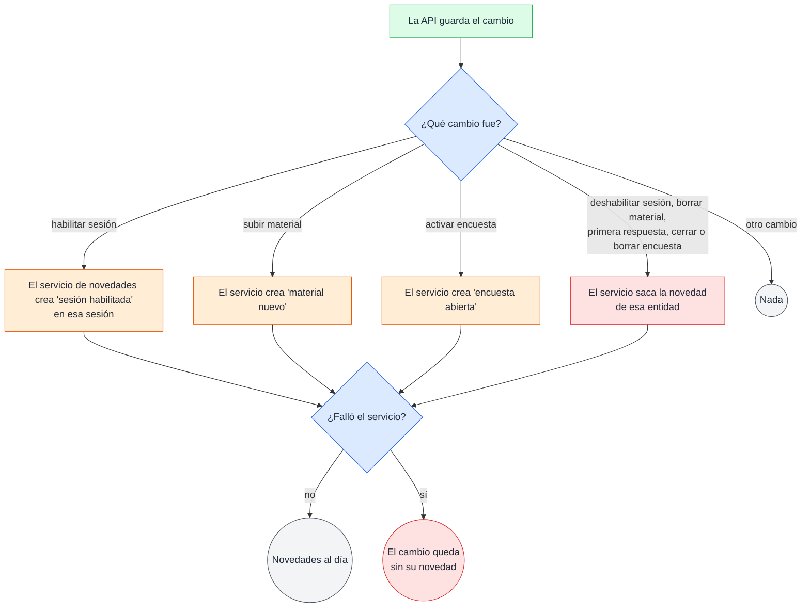
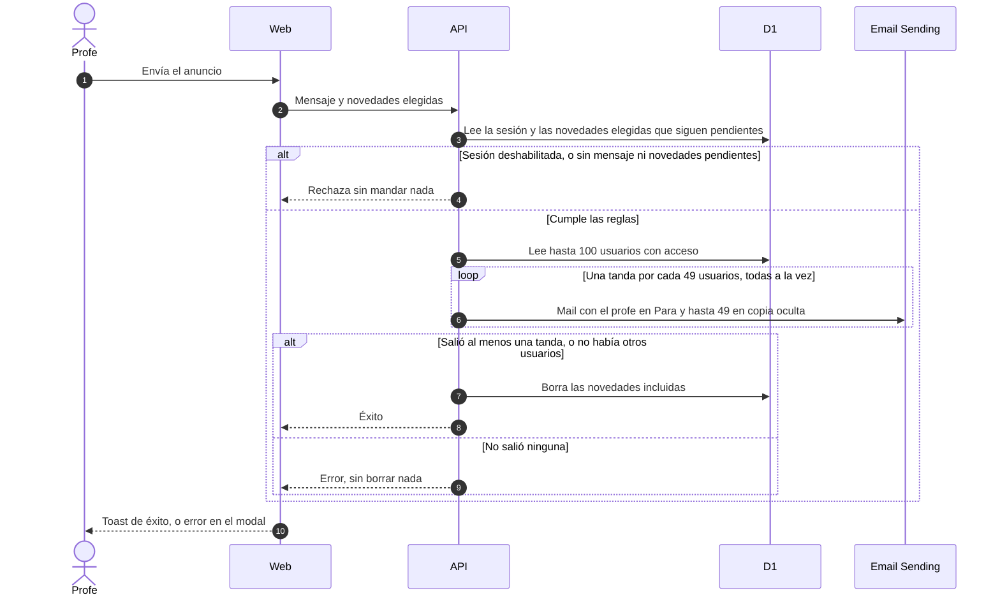

# Novedades por mail

## 🔭 Resumen

Una novedad es algo nuevo de una sesión que el profe todavía no anunció: la sesión se habilitó, se subió un material o se activó una encuesta. La API registra cada novedad después de guardar el cambio que la origina, y la saca cuando un cambio posterior la deshace. El profe ve las novedades pendientes en la pestaña Contenido del admin de la sesión, elige cuáles incluir, escribe un mensaje si quiere y manda un anuncio por mail a los usuarios con acceso. La API borra las novedades anunciadas o descartadas, y no guarda el mensaje, que va solo en el mail.

## 💽 Qué guarda una novedad

Una novedad registra algo nuevo de una sesión para que el profe lo pueda incluir en el próximo anuncio; sus campos están en el [modelo de datos](modelo-de-datos.md). La lista no es un historial: una novedad existe solo mientras está pendiente, y la API la borra definitivamente cuando el profe la anuncia, cuando la descarta o cuando un cambio la saca.

## ⚖️ Qué cambios crean y sacan una novedad

Un servicio de novedades dentro de la API crea y saca las novedades. Cada pedido que hace uno de estos cambios guarda primero el cambio y después le pide al servicio que cree o saque la novedad.

Crean una novedad: habilitar una sesión, subir un material y activar una encuesta. Una encuesta se crea en borrador y recién es novedad al activarla (ver [estados de encuestas y sesiones](estados-de-encuestas-y-sesiones.md)). Sacan la novedad de su entidad: deshabilitar la sesión, borrar el material, y en una encuesta la primera respuesta, cerrarla o borrarla. Editar una sesión, un material o una encuesta, y cualquier otro cambio, no tocan las novedades. Hay como mucho una novedad por tipo e id (ver [modelo de datos](modelo-de-datos.md)). Si un cambio crea la novedad de una entidad que ya tiene una, la que ya estaba queda como está. Sacar la novedad de una entidad saca esa única novedad, y sacar una que no existe no hace nada.

Una sesión deshabilitada sigue acumulando novedades de sus materiales y encuestas. Borrar una sesión no toca sus novedades: la sesión queda guardada con la fecha en `deleted_at`, y sus novedades pendientes quedan guardadas con ella.

> [!WARNING] El cambio y su novedad no se guardan juntos
> El servicio de novedades corre después de que el cambio se guardó, no en la misma operación. Si falla, el cambio queda guardado y la lista no lo refleja: falta la novedad que tenía que crearse, o sigue la que tenía que salir. La API registra la falla en su log y responde el pedido igual que si la novedad se hubiera guardado. No avisa al profe ni corrige la diferencia.

## 📋 Novedades pendientes en el admin de la sesión

La pestaña Contenido del admin de una sesión tiene dos columnas: a la izquierda la card de la sesión y el material, y a la derecha "Novedades pendientes". La columna lista las 100 novedades más nuevas de la sesión, de la más vieja a la más nueva, por la fecha del cambio. Si la sesión tiene más, las más viejas aparecen a medida que el profe anuncia o descarta. Cada fila tiene un checkbox para incluir la novedad en el anuncio, una etiqueta con su tipo, la fecha, el nombre, la misma línea que lleva el mail y un tacho para descartar la novedad. Sin novedades, la columna dice "No hay novedades pendientes.", y el profe igual puede redactar un anuncio con solo el mensaje.

El tacho pide confirmación, `¿Descartar "<nombre>"?`, porque una novedad descartada no aparece en ningún anuncio. Al confirmar, el botón Descartar queda en espera hasta que la API borra la novedad, y la novedad sale de la lista. La novedad puede ya no existir porque la sacó un cambio, salió en otro anuncio o la descartó otra pestaña. En ese caso el descarte cuenta como hecho y el diálogo se cierra igual. Si el descarte falla, el diálogo queda abierto con el error "No se pudo descartar la novedad. Probá de nuevo.".

"Redactar anuncio", debajo de la lista, abre el modal del anuncio. El modal abre con el mensaje vacío. El profe escribe el mensaje y ve las novedades que eligió, sin poder cambiarlas ahí. Si no eligió ninguna, el modal dice "Ninguna novedad elegida.". "Enviar anuncio" se habilita cuando hay un mensaje, al menos una novedad elegida o las dos cosas. El envío es una acción en espera, según la regla de [carga y acciones de la web](carga-y-acciones-de-la-web.md): mientras se envía, el botón dice "Enviando…" con un spinner, y Cancelar y la X quedan deshabilitados. Cuando el envío sale, el modal se cierra, las novedades incluidas salen de la lista, las no elegidas quedan pendientes para el próximo anuncio, y aparece el toast de éxito "Anuncio enviado.". Si el envío falla, el error "No se pudo enviar el anuncio. Probá de nuevo." aparece dentro del modal, que queda abierto con el mensaje y las novedades elegidas para volver a enviar.

Con la sesión deshabilitada, "Redactar anuncio" queda deshabilitado y la columna dice "Habilitá la sesión para mandar un anuncio.".

> [!NOTE] Por qué solo se anuncia una sesión habilitada
> El único link del mail lleva a la sesión, en el inicio del estudiante, y un estudiante no puede entrar a una sesión deshabilitada. La API hace el mismo control al recibir el envío.

La web vuelve a pedir las novedades después de cada acción del profe que las afecta: habilitar o deshabilitar la sesión, subir o borrar material, y activar, cerrar o borrar una encuesta. Cuando una encuesta recibe su primera respuesta, la API saca su novedad sin que el profe haga nada, y la lista lo muestra la próxima vez que la web pide los datos de la sesión, cada cinco minutos (ver [componentes](componentes.md)).

[Prototipo del admin de una sesión, con las novedades pendientes y el modal del anuncio en la pestaña Contenido](../prototipos/admin-sesion.html)

## 📩 Cómo sale el anuncio

El profe envía el anuncio (1) y la web le manda a la API el mensaje y las novedades elegidas (2). La API lee la sesión y las novedades elegidas, y vuelve a controlar que la sesión esté habilitada y que haya mensaje o novedades (3). Una novedad elegida puede ya no estar pendiente porque la sacó un cambio o salió en otro anuncio. Esa novedad queda afuera del mail sin error, y el control cuenta solo las que siguen pendientes. Si algo no se cumple, la API rechaza el pedido y no manda nada (4).

> [!NOTE] Por qué la API vuelve a controlar lo que la pantalla ya controló
> El backend controla siempre las reglas de negocio. La pantalla las controla para que el profe no intente un envío que no corresponde; la que decide si el anuncio sale es la API.

La API lee los usuarios con acceso, como mucho los 100 que se registraron primero (5), arma el mail y lo manda dentro del mismo pedido, así que el profe espera hasta que sale. Cada mail lleva al profe que envía en el "Para" y hasta 49 de los demás usuarios con acceso en copia oculta (6). Con más de 49 usuarios además del profe sale una tanda por cada 49, todas a la vez, y el profe recibe una copia por tanda. Nadie puede darse de baja.

> [!NOTE] Por qué el profe que envía va en el "Para"
> Así recibe el mismo mail que los estudiantes y puede ver que llegó bien. Los estudiantes van en copia oculta, y en el "Para" ven la dirección del profe.

> [!NOTE] Por qué las tandas son de 49
> Email Sending acepta hasta 50 direcciones por mail. El profe ocupa una en cada tanda, y quedan 49 para los usuarios en copia oculta.

> [!WARNING] Más de 100 usuarios con acceso
> La API lee como mucho 100 usuarios con acceso, contando al profe que envía: los 100 que se registraron primero. Si hay más, los que se registraron después no reciben el mail, y ni la API ni la web le avisan al profe.

Las tandas son best effort: la API intenta mandar todas, y no reintenta una tanda que falla. Si salió al menos una, la API borra las novedades incluidas (7) y responde éxito (8); las que el profe no eligió quedan pendientes. Si el profe que envía es el único usuario con acceso, no hay tandas. La API no manda ningún mail, borra las novedades incluidas y responde éxito igual. Si hubo tandas y no salió ninguna, responde error y no borra nada (9). La web muestra el toast de éxito, o deja el modal abierto con el error (10).

> [!WARNING] Una tanda que falla no se avisa
> Si falla una tanda y sale otra, el profe ve "Anuncio enviado." y los usuarios de la tanda que falló no reciben el mail. Las novedades incluidas ya se borraron, así que no se pueden volver a elegir. La única señal es que el profe recibe una copia menos. Lo mismo pasa si una tanda sale pero no les llega a algunos de sus destinatarios: la API la cuenta como enviada.

> [!WARNING] Un anuncio sin destinatarios se ve como enviado
> Si el profe que envía es el único usuario con acceso, la API no manda ningún mail y el profe ve "Anuncio enviado.". Las novedades incluidas se borran igual, y el profe tampoco recibe su copia.

> [!WARNING] Dos envíos a la vez en la misma sesión
> La API no coordina dos envíos de la misma sesión. Si dos profes mandan un anuncio a la vez con la misma novedad elegida, los dos pedidos la leen antes de que alguno la borre, y la novedad sale en los dos mails.

## ✉️ El mail del anuncio

| Parte | Sale de | Forma |
|---|---|---|
| De | la dirección de la app | `no-reply@kurasu.asermax.com` |
| Para | el profe que envía | su dirección, en cada tanda |
| Copia oculta | los demás usuarios con acceso, de los primeros 100 | hasta 49 por tanda |
| Asunto | el título de la sesión | `Novedades de la sesión "<título>"` |
| Mensaje | lo que escribe el profe | tal cual; falta si no escribió nada |
| Novedades | cada novedad incluida, de la más vieja a la más nueva | una línea por novedad, con el texto fijo de su tipo, en pasado |
| Link | la sesión | el botón "Ir a la sesión", a la home o a la home con la sesión abierta |

| Tipo de novedad | Nombre | Línea en el mail |
|---|---|---|
| Sesión habilitada | el título de la sesión | `Se habilitó la sesión "<título>".` |
| Material nuevo | el nombre del material | `Se agregó el material "<nombre>".` |
| Encuesta abierta | la consigna de la encuesta | `Se abrió la encuesta "<consigna>".` |

El asunto no lleva el número de la sesión, que el estudiante no ve. El cuerpo lleva, en este orden, el mensaje del profe tal como lo escribió, las novedades incluidas y el link a la sesión. Sin mensaje, el cuerpo empieza por las novedades. Sin novedades, lleva el mensaje y el link. Las novedades no llevan link propio: el único link del mail es el de la sesión. Si la sesión es la destacada en el momento del envío, el link lleva a la home, donde la destacada está arriba. Si no, lleva a la home con `?sesion=<id>`, y la home abre esa sesión entre las anteriores y la deja en el centro de la pantalla (ver [estados de encuestas y sesiones](estados-de-encuestas-y-sesiones.md)). El mail no saluda al estudiante por su nombre y no tiene pie, link para darse de baja ni texto legal.

> [!WARNING] El link de un mail viejo a la destacada
> La API decide si la sesión es la destacada en el momento del envío. Si después el profe habilita una sesión que está más adelante en la lista, un mail viejo con el link a la home lleva a una home con la nueva destacada arriba, y la sesión del anuncio queda plegada entre las anteriores. Al revés, si una sesión anunciada con `?sesion=<id>` pasa a ser la destacada, el link lleva a la home y no abre nada más, porque la destacada ya está arriba.

El mail tiene la marca de la app: una card con el cuervo y "kurasu" arriba, el mensaje como párrafo, las novedades en un bloque con el título "Novedades", y el botón "Ir a la sesión" alineado a la derecha. Sale con una parte HTML y una parte de texto plano con el mismo contenido: el mensaje, "Novedades" con una línea por novedad, y "Ir a la sesión:" con la URL.

Por ejemplo, la sesión "Context engineering" tiene 100 usuarios con acceso, contando al profe que envía. Un anuncio con el mensaje "¡Nos vemos el jueves!" y dos novedades elegidas, la sesión habilitada el 14/10 y el material "slides-sesion-3.html" subido el 15/10, sale en tres mails, con 49, 49 y 1 usuarios en copia oculta. Cada uno tiene el asunto `Novedades de la sesión "Context engineering"`, y en el cuerpo el mensaje, las líneas `Se habilitó la sesión "Context engineering".` y `Se agregó el material "slides-sesion-3.html".`, y el botón a la sesión.

[Prototipo del mail del anuncio, con mensaje y novedades, solo mensaje o solo novedades, y su parte de texto plano](../prototipos/mail-anuncio.html)

---

Related: [modelo de datos](modelo-de-datos.md), [componentes](componentes.md), [estados de encuestas y sesiones](estados-de-encuestas-y-sesiones.md), [carga y acciones de la web](carga-y-acciones-de-la-web.md), [login y acceso](login-y-acceso.md)
