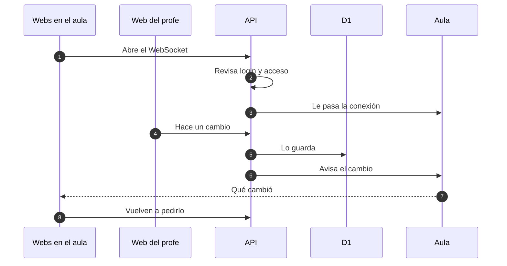
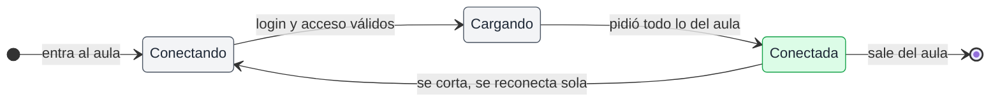

# Tiempo real del aula

## 🔭 Resumen

El aula de cada sesión es un Durable Object, y la web le abre un WebSocket mientras el estudiante está en la pantalla del aula o el profe tiene abierta la página de la sesión. Quien está conectado al aula cuenta como presente. La API guarda primero en D1 cada cambio del aula (la slide, las encuestas, las manos y las preguntas), y el aula solo avisa qué cambió: cada web conectada vuelve a pedirlo a la API. Los presentes los lleva el aula, a partir de sus conexiones abiertas. Fuera del aula, cada pantalla carga sus datos al abrirse, los vuelve a pedir cada cinco minutos y no recibe avisos.

## 📩 Cómo viaja un cambio

Al entrar al aula, la web abre el WebSocket (1). El Worker de la API revisa el login y el acceso (2) y le pasa la conexión al aula de esa sesión (3).

Cuando alguien cambia algo del aula, sea el profe o un estudiante que levanta la mano o deja una pregunta (4), la API lo guarda en D1 (5) y le avisa al aula (6). El aula les dice a los conectados qué cambió (7), y cada web vuelve a pedir eso a la API (8). El aviso dice solo qué cambió, y los datos salen siempre de la API, que es la que revisa el acceso. Así viajan la slide, las encuestas, las manos y las preguntas; cómo viaja la slide en detalle está en [API de las slides](api-de-las-slides.md).

La web vuelve a pedir los nombres y los avatares cada cinco minutos, como el resto de sus datos (ver [componentes](componentes.md)); el aula no avisa esos cambios.

> [!WARNING] Perder el acceso no corta la conexión
> La API revisa el login y el acceso una sola vez, al abrirse el WebSocket. Quien pierde el acceso sigue recibiendo avisos hasta que se desconecta. Los pedidos que hace a la API después de cada aviso fallan con el error de acceso, y la web lo manda al login (ver [login y acceso](login-y-acceso.md)).

## 🟢 Conexión y presentes

Presente es quien está conectado: el estudiante mientras está en la pantalla del aula, y el profe mientras tiene abierta la página de la sesión, en cualquier pestaña. El estudiante que sale del aula desaparece de Presentes, y reaparece al volver. Cuando alguien entra o sale, el aula misma les avisa a los conectados, sin pasar por la API ni por D1.

Si la conexión se corta, la web avisa y se reconecta sola. Al reconectarse vuelve a pedir todo lo del aula, y recién después sigue con los avisos. Mientras el usuario está desconectado, los demás lo ven fuera de Presentes.

> [!NOTE] Por qué la web pide todo antes de seguir con los avisos
> Mientras la conexión está cortada, la web no recibe avisos. Al pedir todo lo del aula primero, no se pierde nada de lo que cambió mientras tanto.

La mano levantada, una fila de `RaisedHand`, y la slide actual, en `current_slide` y `current_step` de la `Session`, viven en D1, no en la conexión, así que no se pierden con un corte ni con un deploy, que reinicia el aula y corta todas las conexiones. La mano sigue levantada si el estudiante sale y vuelve, hasta que alguien la baja.

El aula sigue andando aunque el profe se desconecte: los estudiantes siguen votando, preguntando y levantando la mano. Solo desaparece seguir al profe, hasta que vuelve.

## 🖥️ Pantalla del aula

El estudiante solo puede entrar al aula de la sesión destacada, esté el profe o no. Ve la slide actual al centro, con los controles de navegación de la web, y un panel con Encuestas, Preguntas y Material; en celular, la slide va arriba y el panel abajo. Seguir al profe aparece solo con el profe conectado (ver [API de las slides](api-de-las-slides.md)). En Presentes ve a cada conectado con su avatar, su nombre y su mano, y levanta y baja la suya. Las preguntas respondidas no se ven.

[Prototipo del aula del estudiante, en celular y escritorio](../prototipos/aula-responsive.html)

El profe conduce el aula desde la pestaña Aula del admin de la sesión, con la slide grande y el mismo panel que el estudiante: maneja las encuestas, marca preguntas como respondidas y baja manos. Cuando el profe está en otra pestaña de la sesión, la pestaña Aula muestra badges con las preguntas nuevas y las manos levantadas.

[Prototipo del admin de la sesión, con la pestaña Aula](../prototipos/admin-sesion.html)

## 🗄️ Cómo queda el aula en el navegador

El navegador guarda en su localStorage cómo dejó cada uno el aula, junto con el resto del estado local descrito en [componentes](componentes.md):

| Qué guarda el navegador | Dónde se usa |
|---|---|
| Panel del aula oculto | Aula del estudiante |
| Presentes plegado | Aula, estudiante y profe |
| Pestaña elegida del panel | Aula, estudiante y profe |

El estado del aula es uno solo para todas las sesiones: el panel que el estudiante ocultó en una sesión aparece oculto en la siguiente.

---

Related: [componentes](componentes.md), [API de las slides](api-de-las-slides.md), [login y acceso](login-y-acceso.md), [estados de encuestas y sesiones](estados-de-encuestas-y-sesiones.md), [modelo de datos](modelo-de-datos.md)
